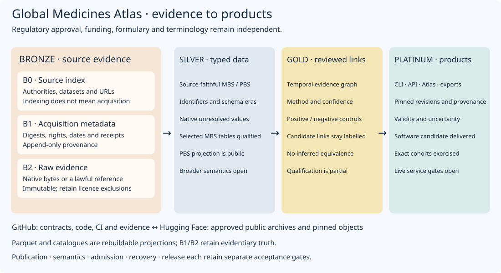
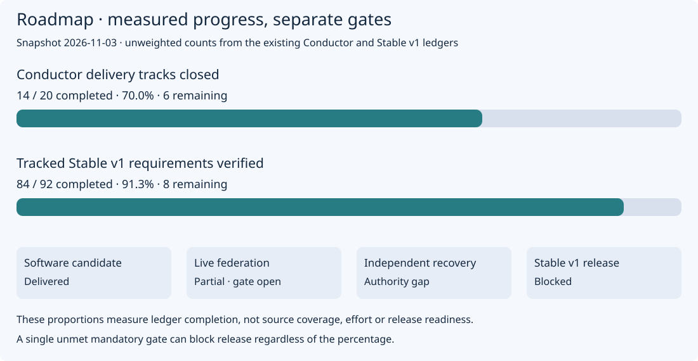

# Global Medicines Atlas

[](https://github.com/edithatogo/global-medicines-atlas/actions/workflows/test-goblin.yml)
[](https://github.com/edithatogo/global-medicines-atlas/actions/workflows/security-context.yml)
[](https://app.codecov.io/gh/edithatogo/global-medicines-atlas)
[](https://huggingface.co/datasets/edithatogo/global-medicines-atlas-catalogue)
[](https://doi.org/10.5281/zenodo.21734811)
[](https://www.python.org/downloads/)
[](LICENSE)

Global Medicines Atlas is an evidence-first system for comparing medicine
regulatory approval, public funding, formulary status, and terminology across
jurisdictions.

The project keeps those dimensions independent. A terminology match, product
listing, price, or formulary entry is never treated as regulatory approval
without source-specific evidence.

> **v1.0.0 scope · 14 November 2026:** research software using existing,
> revision-pinned public archives. Australian federation requirements M-105
> through M-112, complete historical coverage and a production service remain
> unqualified. The `v1.0.0rc1` Zenodo DOI identifies that earlier prerelease.

[Use the software](#use-the-atlas) ·
[Browse public data](https://huggingface.co/datasets/edithatogo/global-medicines-atlas-catalogue) ·
[Roadmap](#roadmap-and-completion) · [Cite](#citation) ·
[Security](SECURITY.md) · [Support](SUPPORT.md)

## Capability status

| Capability | Current evidence |
|---|---|
| Python 3.15.1 package, CLI, API and Atlas | Bounded software candidate integrated; wheel/sdist consumers verified |
| Public source archives | Available on Hugging Face; exact editions, rights and exclusions apply |
| MBS/PBS typed and linked evidence | Selected MBS cohort qualified; broader semantics and derived delivery incomplete |
| Testing and hardening | Protected CI, mutation/performance tests, CodeQL, dependency audit, SBOM and coverage gates |
| Production API/Atlas and current global coverage | External qualification required; no hosted service claimed |
| Software v1.0.0 | Scoped software release; Australian federation remains incomplete |

## Medallion architecture



Bronze is one medallion layer with three internal strata. **B0** indexes sources;
**B1** retains append-only acquisition/provenance records; **B2** retains immutable
native bytes or a lawful reference. Source-faithful Parquet and catalogues are
rebuildable projections. Silver preserves source meanings and explicit unknowns;
Gold qualifies relationships; Platinum presents provenance-aware products.
See the [current architecture and progress](docs/project-overview.md).

## Roadmap and completion

<!-- gma-progress:start -->


**14/20 delivery tracks closed (70%); 84/92 tracked Stable v1 requirements verified (91.3%).** Measured on 3 November 2026. 6 tracks and 8 requirements remain open.

These are separate, unweighted ledger counts, not worldwide source coverage, effort or release readiness. A single mandatory gate can block release.

See the [track registry](conductor/tracks.md), [qualification contract](quality/qualifications/stable-v1-contract.json), [roadmap](conductor/roadmap.md) and [snapshot](docs/project-status.json).
<!-- gma-progress:end -->

## Public data and reproducibility

GitHub hosts code, contracts and receipts; Hugging Face hosts approved public
archives and projections. Start with the
[source catalogue](https://huggingface.co/datasets/edithatogo/global-medicines-atlas-catalogue).
Selected linked archives include:

| Archive | Scope |
|---|---|
| [Australian MBS](https://huggingface.co/datasets/edithatogo/australian-mbs-source-archive) | Service benefits, source editions and selected qualified Silver tables |
| [Australian PBS](https://huggingface.co/datasets/edithatogo/australian-pbs-source-archive) | Funding/formulary source archive and published projections |
| [Historical NZULM 2023](https://huggingface.co/datasets/edithatogo/nzulm-2023-source-archive) | 102 permitted historical members; licence exclusions retained |

The [Australian MBS and PBS archive reconciliation](docs/qualification/australian-public-archive-reconciliation-20261113.md)
links exact archive revisions, the September 2025 PBS schedule ZIP and its 33
CSV members, and public utilisation files including MBS demographics from 1993.

Pin a full revision and verify the object digest before use. Publication and
byte verification do not establish semantic qualification, v4 admission,
complete historical coverage or clinical suitability. Each dataset card and
source receipt defines its rights and limits.

## Current scope

- New Zealand NZULM/NZMT and FHIR adapter boundary.
- Tiered offline-first RxNorm/RxNav-compatible terminology resolution.
- Governed global API and downloadable-source catalog.
- Initial country contracts for New Zealand, Australia, the United States,
  United Kingdom, Canada, Japan, and the European Union.
- Fixture-driven Drugs@FDA bulk projection.

Detailed requirements, design, plans, and evidence are under
[`conductor/`](conductor/index.md). GitHub issues mirror each active Conductor
track in the
[Global Medicines Atlas Conductor Project](https://github.com/users/edithatogo/projects/35).

## Maintainer workflow

This is a single-accountable-maintainer repository with automated evidence
rather than invented reviewer roles. Start with [`AGENTS.md`](AGENTS.md) and
the machine-readable [context manifest](.context/project.toml). Pull requests
run the complete Python 3.15.1 harness, locked Mojo canary, context-drift checks,
CodeQL, Zizmor, dependency audit, and SBOM generation. Licensing, credentials,
public release, external publication, compatibility archival, and
consequential interpretation remain explicit human gates.

Codecov is active for this public repository. The project gate is 91%, the
patch gate is strictly above 90%, and each Test-Goblin lane uploads an
independently visible flag through GitHub OIDC. See the
[testing and Codecov contract](docs/testing/test-goblin.md#coverage-and-codecov)
for the fail-closed policy.

Relevant maintainer-owned GitHub and Hugging Face resources are governed by the
[ecosystem reuse registry](docs/ECOSYSTEM_REUSE.md), which runs in the routine
harness to prevent parallel implementations and untracked copying.

The evidence-gated [v0.1-to-v1.0 roadmap](conductor/roadmap.md) maps product
features and maturity levels to Conductor tracks and the native GitHub
[roadmap issue hierarchy](https://github.com/edithatogo/global-medicines-atlas/issues/44).

## Use the atlas

### Five-minute local start

The authoritative runtime is CPython 3.15.1. From a source checkout:

```console
uv sync --python 3.15.1 --locked --no-default-groups
uv run --no-sync python --version
uv run --no-sync global-medicines-atlas --help
uv run --no-sync global-medicines-atlas comparison --help
```

Queries require an explicit governed DuckDB database and a deployment-owned
cursor secret; the repository never substitutes test fixtures for production
data. The optional LanceDB-backed semantic layer is installed with
`--extra semantic`. See the user guide for PowerShell commands and the current
API/Atlas application-factory boundary.

For development and the focused smoke check, use the minimal locked test setup
in [Contributing](CONTRIBUTING.md). The current finish line is the
[bounded software candidate](conductor/system-completion.md); complete
Australian federation and Stable v1 promotion remain later, gated milestones.

Start with the [task-oriented user guide](docs/user-guide.md) to:

- install the core package or opt into semantic retrieval;
- exercise the CLI, API contract, and server-rendered Atlas;
- interpret regulatory, funding, uncertainty, and comparison-validity results;
- reproduce the repository locally or rehearse recovery; and
- report support, security, or medicine-data integrity issues.

The repository provides source-checkout and built-artifact workflows and an
archived prerelease. No package-index distribution, hosted API or hosted Atlas
service is claimed. The [configured service guide](docs/qualification/configured-service-61.md)
documents the installed ASGI factory and its production-data requirements. Commands requiring
a canonical DuckDB database do not silently substitute the repository's
representative test fixtures for production medicine data.

## Interpreting a comparison

For example, a medicine may have a current regulatory approval from Medsafe
while having no confirmed PHARMAC funding assertion for the same indication
and observation date. The Atlas reports those as two evidence states. It does
not convert missing funding evidence into “not funded,” and it does not infer
therapeutic equivalence from an RxNorm or lexical match.

## What this project does not claim

- It does not provide medical advice or prescribing recommendations.
- A cross-jurisdiction match does not establish therapeutic equivalence,
  substitutability, interchangeability, or equal benefit.
- Catalogue coverage and representative fixtures do not establish complete or
  current global coverage.
- Repository visibility does not grant rights in third-party medicine data.
- A green workflow is not evidence that an external dataset, DOI, service, or
  preregistration has been published.

## Data boundaries

Only approved source material is public. The historical NZULM archive excludes
the confirmed licensed maps/guides and mixed ZIP; restricted terminology,
credentials and private evidence remain private. Source
catalog entries describe access surfaces; they do not claim complete ingestion
or global coverage. Read the [software and source-data rights](docs/data-sources/SOURCE_RIGHTS.md)
and [stable-v1 qualification limitations](docs/qualification/stable-v1-contract.md)
before reusing code, source material, or derived outputs.

## Citation

Cite the software with the exact release or commit used.
The [archived software prerelease](https://github.com/edithatogo/global-medicines-atlas/releases/tag/v1.0.0rc1)
has DOI [10.5281/zenodo.21734811](https://doi.org/10.5281/zenodo.21734811).
GitHub's **Cite this repository** uses [CITATION.cff](CITATION.cff). For data,
also cite the upstream source, source edition, Hugging Face repository, full
revision, object path and SHA-256; the software DOI does not identify every
subsequent dataset snapshot. The [Apache-2.0 licence](LICENSE) covers
project-owned code; [source-specific data rights](DATA_LICENSE.md) remain separate.

## Project navigation

- [User guide](docs/user-guide.md)
- [OpenAPI compatibility contract](contracts/openapi-readonly-v1.json)
- [Global source census](docs/data-sources/global-source-census.md)
- [Coverage qualification](docs/qualification/stable-v1-measured-coverage.md)
- [Academic protocol](docs/research/academic-protocol.md)
- [Security policy](SECURITY.md)
- [Contributing](CONTRIBUTING.md)
- [Citation metadata](CITATION.cff)
- [Software licence](LICENSE) and [derived-data licence boundary](DATA_LICENSE.md)
- [Versioned roadmap](conductor/roadmap.md)
