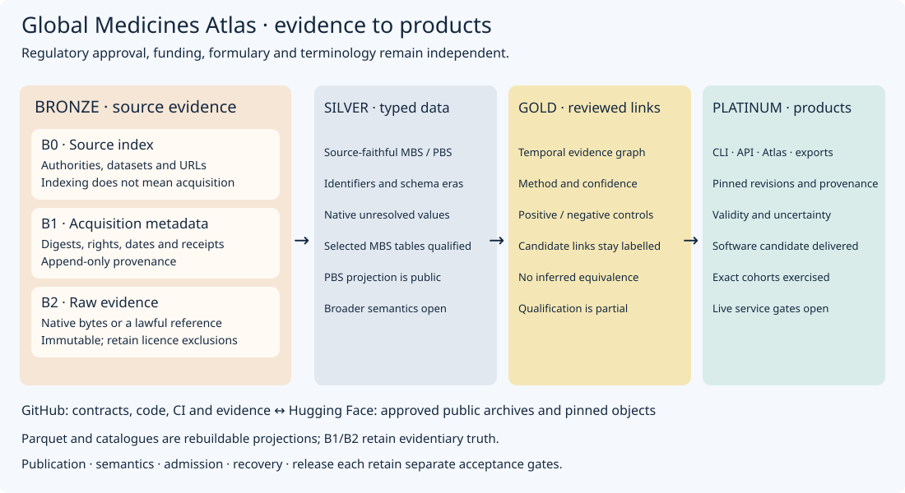
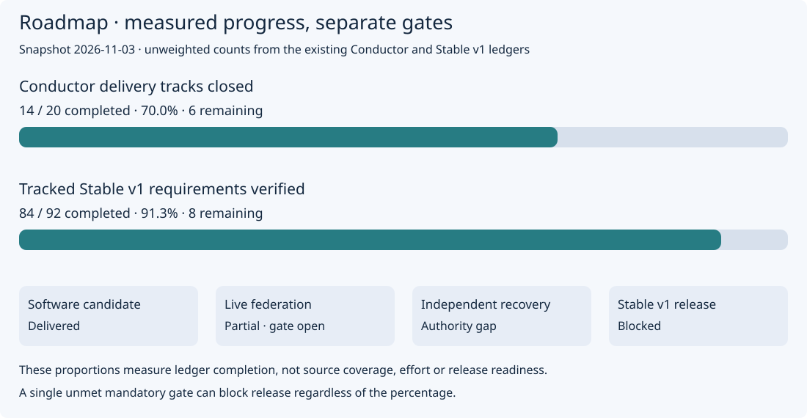

# Project architecture and measured roadmap

Snapshot: **3 November 2026**. GitHub owns the software, contracts and evidence;
[Hugging Face](https://huggingface.co/datasets/edithatogo/global-medicines-atlas-catalogue)
hosts the approved public archives. Their pages link to the same diagrams.

## Medallion model in this use case



| Layer | Applied to GMA | Evidence boundary |
|---|---|---|
| Bronze B0 | Authorities, datasets and acquisition URLs | Discovery is not acquisition or qualification |
| Bronze B1 | Rights, SHA-256, retrieval/effective dates and receipts | Append-only provenance |
| Bronze B2 | Immutable native files or a lawful immutable reference | Source terms and exclusions still apply |
| Silver | Source-faithful typed MBS/PBS structures and unresolved fields | Selected cohorts qualify; broader meanings remain open |
| Gold | Temporal evidence links with method, confidence and reviewed controls | A candidate link is not equivalence or eligibility |
| Platinum | CLI, read-only API, Atlas, comparisons and deterministic exports | Software and exact-cohort checks do not qualify a global live service |

B0/B1/B2 are **three strata within Bronze**, not additional medallion levels.
Source-faithful Parquet, DuckDB and catalogue views are rebuildable projections;
the immutable source payload and B1/B2 receipt remain evidentiary truth.
Approval, funding, formulary and terminology assertions stay independent.

## Completion proportions



| Measure | Complete | Denominator | Proportion | Source |
|---|---:|---:|---:|---|
| Closed delivery tracks | 14 | 20 | 70% | [Conductor registry](../conductor/tracks.md) |
| Verified tracked Stable v1 requirements | 84 | 92 | 91.3% | [Qualification contract](../quality/qualifications/stable-v1-contract.json) |

These are **unweighted counts**, not estimates of effort, source-population
coverage or release readiness. An in-progress track receives no partial credit.
Closing a software track can transfer an external follow-up to an open issue;
therefore track closure does not imply every external gate is met. The
[release reconciliation](../quality/qualifications/stable-v1-release-readiness-reconciliation.json)
still blocks Stable v1 on Australian federation and records independent recovery
authority separately. The [roadmap](../conductor/roadmap.md) retains the full scope.

The [snapshot](project-status.json) binds the two input digests. Regenerate or
check the diagrams using the governed interpreter:

```sh
uv run --python 3.15.1 python scripts/render_project_overview.py
uv run --python 3.15.1 python scripts/render_project_overview.py --check
```

When refreshing the measurement date, update `AS_OF` in the renderer and review
the accompanying prose counts. No historical acceptance receipt is rewritten.

## Homepage maturity

The homepage exposes protected CI/security/coverage badges, runtime and code
licence, public data, a persistent software citation, user setup, support,
source-rights boundaries and this measured roadmap. These are presentation and
navigation controls. Operational maturity still requires the missing live
service, production-data, wider federation and release evidence. No standalone
GitHub Pages deployment is configured in the bounded readback; the repository
README is the GitHub homepage for this change.
